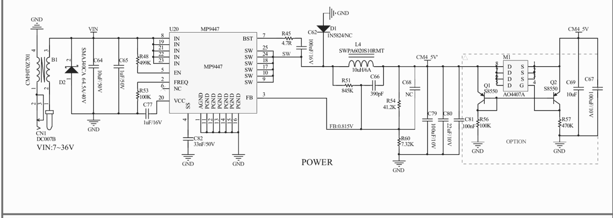
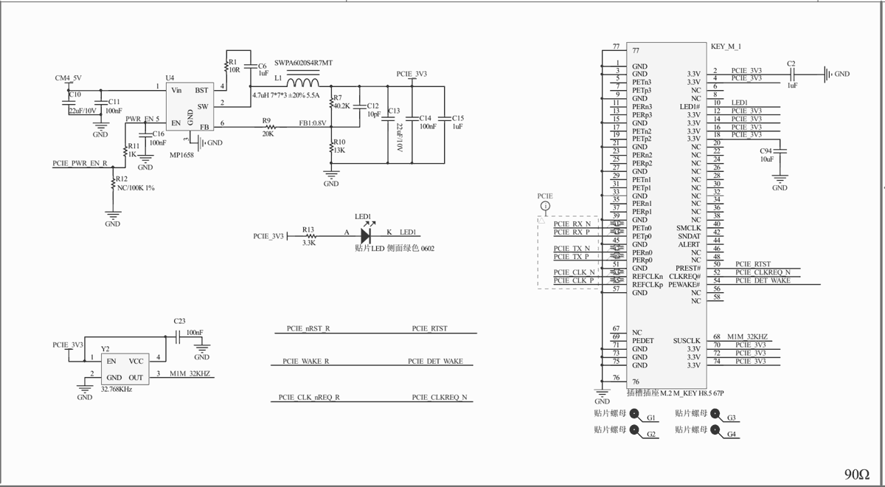
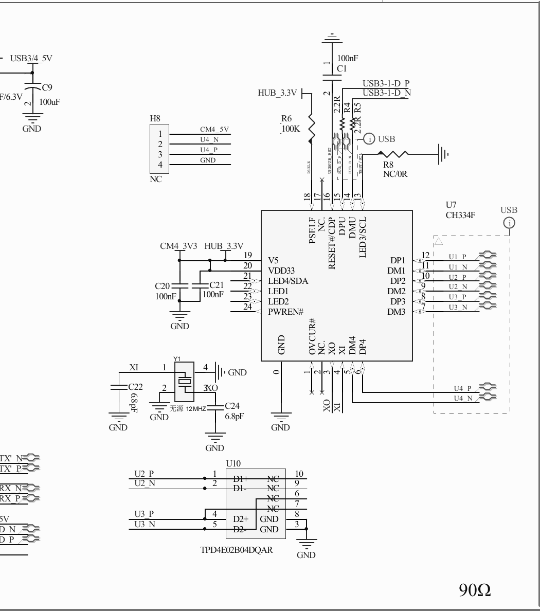
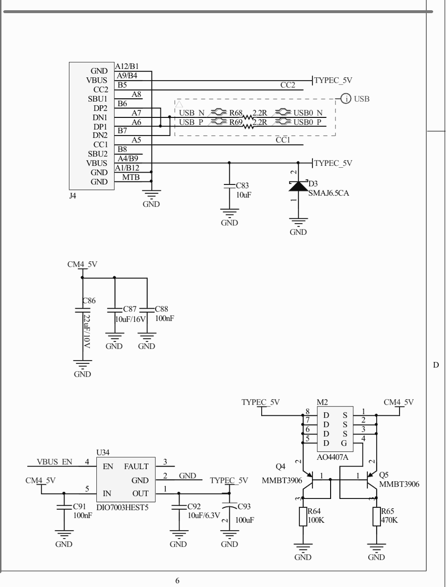

# CM5-DUAL-ETH-BASE: what the schematic says

Source: [Waveshare CM5-DUAL-ETH-BASE schematic](https://files.waveshare.com/wiki/CM5-DUAL-ETH-BASE/CM5-DUAL-ETH-BASE-Sch.pdf), a one-page PDF read on 2026-10-12, together with the [product page](https://www.waveshare.com/cm5-dual-eth-base.htm) and [wiki](https://www.waveshare.com/wiki/CM5-DUAL-ETH-BASE). Everything here is **paper** evidence. Values marked "calculated" come from the schematic's resistor values; they are not measurements.

Board: 109.0 x 91.5 mm. It takes every CM5 variant, with a TF slot for Lite modules. Price is $54.99 for the board alone. The CM5-DUAL-ETH-BOX-A at $69.99 adds a metal case, fan and 12 V/4 A adapter.

## Power input

- **Input:** CN1 is a DC007B barrel jack rated 7 to 36 V, followed by a CM9070Z701 common-mode choke. D2 is an SMAJ40CA TVS (40 V standoff, about 64.5 V clamp). A 3S pack (9.0 to 12.6 V) is well inside this range.
- **Buck:** U20 is an MP9447 with a 10 µH / 6 A inductor (SWPA6020S10RMT). It makes `CM4_5V`, which feeds the CM5, the USB ports and both 3.3 V regulators.
- **Output voltage:** calculated at about 5.40 V. That is the annotated 0.815 V feedback reference times (1 + R54 41.2 k / R60 7.32 k). This is above the CM5's 4.75 to 5.25 V input range ([CM5 datasheet](https://datasheets.raspberrypi.com/cm5/cm5-datasheet.pdf), pins 77 to 87), though below its 6.0 V absolute maximum. **Measure `CM4_5V` before seating a CM5** ([bring-up.md](bring-up.md) step 2).
- **No reverse-polarity FET on the input path.** M1 (AO4407A) only selects between the barrel and USB-C 5 V, and it is marked OPTION. The bench node puts an LM74700 ideal-diode stage between the pack and the jack ([build-list.md](build-list.md)).
- **Type-C to 5 V:** M2 (AO4407A) ORs the USB-C 5 V into `CM4_5V`, and U34 (DIO7003) drives 5 V out of the USB-C port under `VBUS_EN`. Waveshare warns that with DC connected, the USB-C port outputs 5 V. Never power from the DC jack while the Type-C port is plugged into a PC.

## M.2 slot and its 3.3 V rail

- **Slot:** KEY_M_1 is an M.2 M-key socket, H8.5, with nuts for 2230, 2242, 2260 and 2280. It carries one PCIe lane (PETn0/PERn0, CM5 PCIe Gen2 x1; Gen3 is possible with `dtparam=pciex1_gen=3`, which we do not use). `PERST#` comes from `PCIE_nRST`, `CLKREQ#` and `PEWAKE#` are wired, and SUSCLK comes from a 32.768 kHz oscillator (Y2).
- **Rail:** U4 is an MP1658 buck that feeds only `PCIE_3V3`, which reaches the slot's nine 3.3 V pins. Its output is calculated at 0.8 V x (1 + 40.2 k / 13 k), about 3.27 V. It has a 5.5 A inductor, and the MP1658 is a 3 A class part. EN is `PCIE_PWR_EN` from the CM5, so the slot loses power when the CM5 drops that signal.
- **Peripheral rail:** a second MP1658 (U22) makes `PWR_3V3` for the rest of the carrier: header 3.3 V, the 2.5 GbE NIC's LEDs and the hub. The M.2 card does not share it.
- **What this means for the AW7916-AED:** the slot itself can source the card's 3 A request. The open question moves to the Sintech M-key to A+E adapter. Its E-key side has four 3.3 V pins (2, 4, 72, 74); at the usual 0.5 A per contact that is about 2 A, which is inferred, not a datasheet value. The card is 30 x 52 mm and overhangs the adapter's 2230 position, so support its far end on the 2242 or 2260 nut.

## USB

| CM5 root | Goes to |
|---|---|
| USB3-0 (SuperSpeed and USB 2.0) | The USB 3.2 Gen1 Type-A port (J3), with a 2 A switch (DIO7003) |
| USB3-1 SuperSpeed pair | The 2.5 GbE USB NIC. The published schematic leaves the controller IC out; its 0.95 V core rail (MP1605, U13) and the RJ45 (RJ1A) are drawn. Waveshare's product page calls it a "USB to 2500M Ethernet chip". RTL8156-class is our inference, so `r8152` is in the image, but the chip identity is an open vendor question |
| USB3-1 USB 2.0 pair | A CH334F 4-port USB 2.0 hub (U7). Two ports go to the Type-A ports J1/J2 (2 A shared). Port 4 goes to **H8**, an unpopulated 4-pin header (5 V, D-, D+, GND) beside the RTC battery holder. Port 1 is not traced on the published page |
| BCM2712 USB 2.0 (dwc2 OTG, `USB0`) | The USB-C port (J4). `USB0_ID` is strapped to ground (R23 0R) |

**HaLow placement.** The USB-C port is the only root the 2.5 GbE NIC and the hub do not share, so the GW16167's Pier42 USB-C carrier goes there. It needs `dtoverlay=dwc2,dr_mode=host`, which is in our image from [firmware#53](https://github.com/ghostnet-labs/firmware/pull/53). The fallback is the J1/J2 hub ports. For a tidy internal cable later, H8 can carry the same signals.

## 40-pin header

The header is a standard Raspberry Pi pinout, with 3.3 V on pins 1/17 and 5 V on pins 2/4. Our image uses:

| Pin | GPIO | Use |
|---|---|---|
| 3, 5 | GPIO2/3 | i2c-1: INA228 battery monitor (0x40). The carrier's own CAT24C32 EEPROM (0x50) and ATSHA204 (0x64) share this bus |
| 8, 10 | GPIO14/15 | UART0 (`/dev/ttyAMA0`): GNSS NMEA |
| 12 | GPIO18 | GNSS PPS (`/dev/pps0`) |
| 13, 15 | GPIO27/22 | Claimed by the image's i2c-gpio overlay, which exists for the IO-WIRELESS-BASE. Leave them unused |

The canonical V1 pin record is [v1-pinout-and-sequencing.md](../../hardware/v1-pinout-and-sequencing.md). This table covers only the bench carrier.

## Other

- **Gigabit port:** the CM5's own BCM54210PE PHY (`eth0`, IEEE 1588 capable). The 2.5 GbE port is `eth1` and is not assigned to any interface by default.
- **Fan header:** 5 V, 4-pin JST-SH PWM. RTC battery header for the CM5's RTC. PSW and BOOT buttons.
- **Strap resistors** (Multifunction block): `WIFI_EN`, `BT_EN`, `EEPROM_WP`, `ETH_OUT` and `PI_GLOBAL_EN` are all NC by default, so the CM5's own Wi-Fi and Bluetooth stay enabled.
