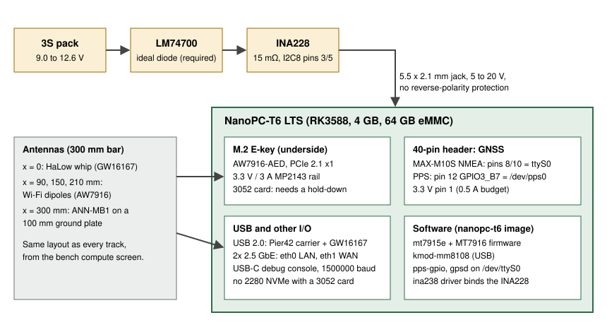

# Bench track: FriendlyElec NanoPC-T6 LTS

This is one of the Stage 2 bench tracks from the [bench compute screen](https://claude.ai/artifact/Sm3hWVZPsHHcJnTMRVeCXe), where it is "Challenger B". It builds one OpenMANET node on a FriendlyElec NanoPC-T6 LTS so it can be compared, line for line, with the CM5 baseline and the other challengers. Status, open questions and results live in [GHO-87](https://linear.app/ghostnet-labs/issue/GHO-87). The overall comparison is [GHO-50](https://linear.app/ghostnet-labs/issue/GHO-50).

Nothing in this folder has been bought, and nothing here has booted on NanoPC-T6 LTS hardware. Every hardware claim is marked **Verified** (with its source and date) or **Unverified**.

## Why this board earns a track

- **It is the only Rockchip board with an official 3.3 V / 3 A E-key rail.**
  - A dedicated MP2143 buck feeds the M.2 E-key slot. The board carries PCIe 2.1 x1 and USB 2.0 to that slot. Verified 2026-10-12 against the [LTS 2310 schematic](https://wiki.friendlyelec.com/wiki/images/4/44/NanoPC-T6_LTS_2310_SCH.pdf), p.30.
  - The [wiki](https://wiki.friendlyelec.com/wiki/index.php/NanoPC-T6) power table gives "M.2 E-Key 3.3V/3A" and "Total 35W". Verified 2026-10-12.
- **It takes the pack directly.** The DC jack is 5.5 x 2.1 mm, "5V~20V, 12V is recommended" (wiki), so 9.0 to 12.6 V from a 3S pack is in range. Verified 2026-10-12. It has **no** reverse-polarity protection, so the LM74700 is required, not optional ([power-budget.md](power-budget.md) §1).
- **It is the cheapest challenger.** The board is $179 (4 GB / 64 GB), against $940 for the Venice kit.
- **It has a 40-pin header with six UARTs**, so the GNSS and PPS wire exactly as on a Raspberry Pi HAT. There is also a USB-C debug console and two 2.5 GbE ports.
- **Its kernel support is upstream.** The LTS device tree landed in Linux v6.12. We backport it into our 6.6 tree; it is about 60 lines on top of the NanoPC-T6 dtsi.

## How the node is built

| Part | Role | Detail |
|---|---|---|
| NanoPC-T6 LTS, 4 GB / 64 GB | Compute, power entry, GNSS header | [build-list.md](build-list.md) |
| AsiaRF AW7916-AED, M.2 3052, in the underside E-key slot | Wi-Fi mesh backhaul (`batmesh1`), the V1 card | [e-key-fit.md](e-key-fit.md), [power-budget.md](power-budget.md) |
| GW16167 HaLow on a Pier42 M.2 E-key to USB carrier | HaLow mesh (MM8108 over USB 2.0) | [build-list.md](build-list.md) |
| SparkFun MAX-M10S breakout and u-blox ANN-MB1 | GNSS with PPS on header pins 8/10/12 | [build-list.md](build-list.md), [bring-up.md](bring-up.md) |
| LM74700 ideal diode and INA228 monitor, between the 3S pack and the DC jack | Reverse/ORing protection and logged input power | [power-budget.md](power-budget.md) |

## The 3052 question, in one picture

The E-key bay is built for a 2230 card. A 30 x 52 mm (3052) AW7916-AED reaches 22 mm past the only standoff, over the RK3588 decoupling field. There is no screw point at its end, a heatsink screw hole sits under it, and it overlaps a 2280 NVMe SSD. **It fits only with changes**: no 2280 SSD, Kapton over the area, and a non-conductive hold-down at the free end. The full analysis is in [e-key-fit.md](e-key-fit.md).

## Defaults this track picked

These were Claude's software and bench defaults, chosen under Justin's standing delegation.

1. **Keep the AW7916-AED (3052) instead of switching to a 2230 card.** It is the V1 card, and the whole point of the track is to run the same radio. The fit needs the changes in [e-key-fit.md](e-key-fit.md) §4. A 2230 MT7916 card is the fallback.
2. **Put HaLow on USB 2.0 through a Pier42 carrier.** The board has only one E-key slot, and the Wi-Fi card takes it. The carrier plugs into a USB 2.0 Type-A port. The internal 10-pin USB header is the tidy option for an enclosure ([bring-up.md](bring-up.md) step 7).
3. **Wire the GNSS to header UART0 (pins 8/10) and PPS to GPIO3_B7 (pin 12).** These are the Raspberry Pi HAT positions, so the same GNSS wiring harness fits the CM5 and this board. The device-tree patch is in [firmware #55](https://github.com/ghostnet-labs/firmware/pull/55).
4. **Use the INA228 like every other track, bound by the kernel driver.** Linux 6.6 needs the v6.17 `ina238` backport for it. [firmware #55](https://github.com/ghostnet-labs/firmware/pull/55) carries the same backport as the CM5 and x86 tracks ([firmware #53](https://github.com/ghostnet-labs/firmware/pull/53), [firmware #54](https://github.com/ghostnet-labs/firmware/pull/54)) and declares the chip in the device tree, so readings appear in `/sys/class/hwmon` with the right shunt value.
5. **Reuse the NanoPC-T6 U-Boot.** The only board difference U-Boot touches is GPIO4_C6, the T6's 4G-modem power pin. It is not connected on the LTS (schematic, Verified 2026-10-12), so driving it does nothing.

## Scorecard

This uses the same six columns as the screen's finalist table. Each cell gives its evidence level:

- **paper**: from datasheets or source.
- **build**: the CI image contains it.
- **boot**: seen working on this board.
- **measured**: a bench number exists.

| Column | Result today | Evidence | What moves it up |
|---|---|---|---|
| Wi-Fi card | ◐ AW7916-AED in the E-key slot on an official 3.3 V / 3 A rail. The 3052 card does not fit cleanly: it needs no 2280 SSD and a hold-down. | paper (schematic, DXF); build (mt7915e and the MT7916 firmware are in the image, built by CI 2026-10-13, [run](https://github.com/ghostnet-labs/firmware/actions/runs/38321030369)) | Caliper check, then bring-up steps 6 and 10: `mt7915e` probes, full TX, mesh against the CM5 |
| HaLow USB | ● GW16167 on a Pier42 USB carrier. `kmod-mm8108` with `MORSE_USB` is in the image. | build (image built by CI 2026-10-13, [run](https://github.com/ghostnet-labs/firmware/actions/runs/38321030369)) | Step 7: `morse` interface up, HaLow mesh against the CM5 |
| GNSS + PPS | ● MAX-M10S on UART0 (`/dev/ttyS0`), PPS on `pps-gpio` (`/dev/pps0`). The DTB is compiled and decompiled with both nodes enabled; gpsd is pointed at `/dev/ttyS0` on first boot. | build (DTB compiled locally with W=1, no warnings; image built by CI 2026-10-13, [run](https://github.com/ghostnet-labs/firmware/actions/runs/38321030369)) | Step 8: `ppstest /dev/pps0`, gpsd 3D fix, C/N0 sweep |
| 3S power | ● 5 to 20 V jack; 3S connects directly. **No reverse-polarity protection** on the board. Worst-case node about 24 W, inside the board's 35 W total. | paper | Steps 9 and 10: input power idle and at full TX, from the pack |
| OpenWrt | ◐ New `friendlyarm_nanopc-t6-lts` device in our 24.10 tree with the backported upstream DTS. The fork's rockchip patch stage was broken by three duplicate patches; [firmware #55](https://github.com/ghostnet-labs/firmware/pull/55) removes them. | build (the NanoPC-T6 LTS image built in CI on 2026-10-13, 50 MB artifact `firmware-nanopc-t6`, [run](https://github.com/ghostnet-labs/firmware/actions/runs/38321030369)); not boot-verified | Step 3: boots the CI image from eMMC |
| Other | ◐ 2x 2.5 GbE, USB-C console, cheapest track. Rated 0 to 70 °C only (wiki), the narrowest of the tracks. Idle power is unpublished. | paper | Idle power from the pack at 25 °C; SoC temperature under load |

## Files

- [build-list.md](build-list.md): every part for one node, with photos, sources and alternates.
- [e-key-fit.md](e-key-fit.md): whether a 3052 card fits the E-key bay, from FriendlyElec's own DXF.
- [power-budget.md](power-budget.md): input range, rail-by-rail budget, pack run time.
- [bring-up.md](bring-up.md): flashing, console and a step-by-step check for each subsystem, with pass criteria.
- [nanopc-power-log.sh](nanopc-power-log.sh): reads the INA228 from `/sys/class/hwmon` and logs CSV.

## Code this track changed

- [firmware #55](https://github.com/ghostnet-labs/firmware/pull/55) on `bench/nanopc-t6`:
  - removes three duplicate rockchip 6.6 patches (`016-v6.13`, `300`, `301`) that stopped the rockchip kernel from preparing at all;
  - backports the upstream v6.12 `rk3588-nanopc-t6-lts` DTS and adds the header GNSS, PPS and I2C wiring;
  - adds the `friendlyarm_nanopc-t6-lts` image, network and U-Boot entries, and a gpsd default;
  - adds the `boards/nanopc-t6` OpenMANET profile and a PR build workflow;
  - carries the shared INA228 driver backport for rockchip.
