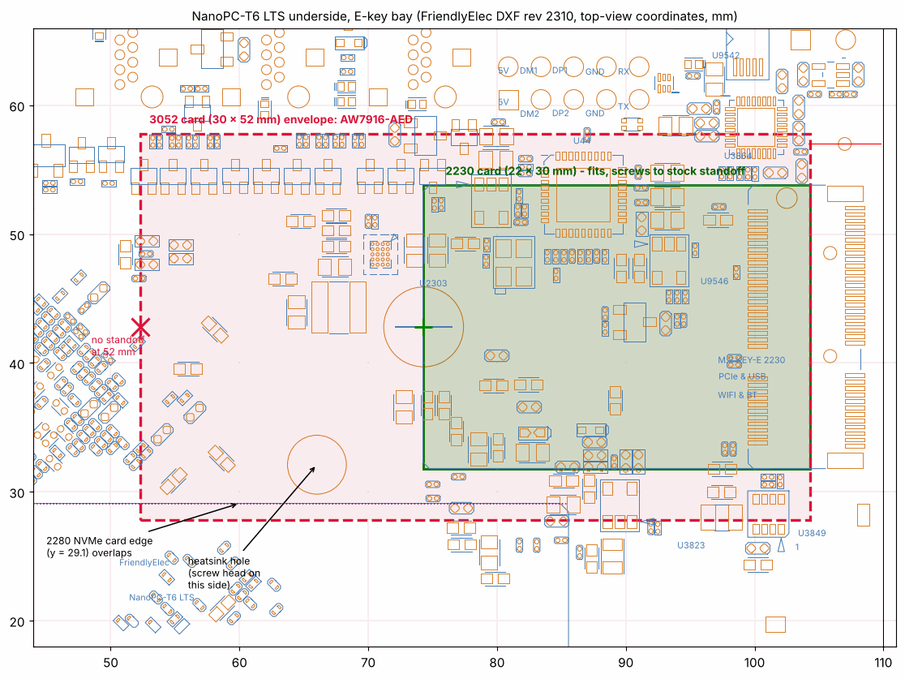
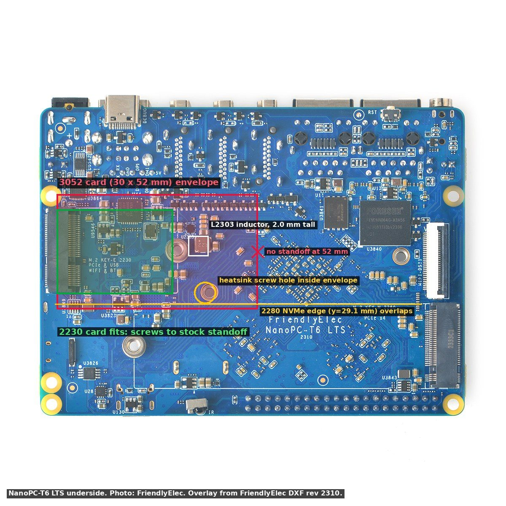

# NanoPC-T6 LTS: does a 3052 card fit the E-key bay?

**Short answer: not cleanly.** The bay is built for a 2230 card. A 3052 card (the AW7916-AED, 30 x 52 mm) seats in the connector and the electrical side is fine, but nothing holds its far end, and it overlaps parts and a second card. It works on the bench with the changes in §4. Confirm with calipers before relying on it. Open question 1 on [GHO-87](https://linear.app/ghostnet-labs/issue/GHO-87).

Everything below is measured from FriendlyElec's own mechanical drawing, the [NanoPC-T6 LTS 2310 DXF](https://wiki.friendlyelec.com/wiki/images/0/08/NanoPC-T6_LTS_2310_DXF.zip), and read against the [LTS 2310 schematic](https://wiki.friendlyelec.com/wiki/images/4/44/NanoPC-T6_LTS_2310_SCH.pdf). Coordinates are in mm in the DXF's top-view frame. The analysis was done on 2026-10-12 and is **paper only**.

## 1. The overlay

The E-key connector sits on the underside, at the board edge. The card's insertion datum is at x = 104.3 and its centreline at y = 42.8. A 2230 card ends at x = 74.3; a 3052 card ends at x = 52.3.

The same envelope over FriendlyElec's photo of the underside:

## 2. What the drawing shows

| Finding | Location | Effect on a 3052 card | Status |
|---|---|---|---|
| The only E-key standoff is at the 30 mm point | (74.3, 42.8), SMTSO-M3-2.5ET, 2.5 mm tall | The card passes over it; there is no screw point at 52 mm | Verified from DXF and schematic |
| No standoff or hole at the 52 mm point | (52.3, 42.8) lands in the RK3588 decoupling capacitor field | The free end is unsupported and sits over live parts | Verified from DXF |
| Heatsink mounting hole inside the envelope | (66.01, 32.11) | A heatsink screw head on this side would press into the card | Verified from DXF; the screw head height depends on the heatsink fitted |
| RK860 buck inductor L2303 | about (65.6 to 69.9, 42.3 to 46.3), WPN4020HR22MT, 4 x 4 x 2.0 mm | 2.0 mm tall under a card that sits about 2.5 mm off the board: about 0.5 mm clearance at the inductor, before card-side components | Verified part and footprint; clearance is **Unverified** (calculated) |
| 2280 NVMe slot | The NVMe card's edge reaches y = 29.1 | Overlaps the 3052 envelope (y 27.8 to 57.8). A 3052 Wi-Fi card and a 2280 SSD cannot both be fitted | Verified from DXF |
| Rail and signals | MP2143 3.3 V / 3 A buck, PCIe 2.1 x1 on `pcie2x1l1`, USB 2.0 from the on-board hub, PERST on GPIO4_A2, W_DISABLE on GPIO4_B5 with a 10K pull-up | Electrically the slot serves a 3052 card exactly like a 2230 one | Verified from schematic p.30 |

## 3. What this means

- **Electrically, yes.** The connector and the 3.3 V / 3 A rail do not care about card length.
- **Mechanically, not as designed.** The card would hang 22 mm past its only standoff, 2.5 mm above a dense capacitor field, with about 0.5 mm over a buck inductor. Vibration or a knock could short the card's back side to the board.
- **It costs the SSD.** No 2280 NVMe drive can be fitted at the same time. The node boots from the 64 GB eMMC, so this is acceptable for the bench.

## 4. Bench plan (working default)

1. **Measure first.** Caliper the standoff height, the L2303 height and the AW7916-AED's back-side components. Record them on GHO-87.
2. **No 2280 SSD** in the M-key slot.
3. **Kapton tape** over the board area under the card, from x = 52 to x = 74.
4. **Hold the free end** with a non-conductive spacer: a 2.5 mm nylon standoff glued to the Kapton is enough on the bench. Do not drill the board.
5. **Do not fit a heatsink screw at (66, 32)** on the underside, or use a low-profile nylon screw.
6. **Keep TX power capped** until bring-up step 10 has passed ([bring-up.md](bring-up.md)).

## 5. Alternatives if the fit fails

- **M.2 E-key extender or riser.** It moves the card off the board onto a flat cable. It adds a PCIe 2.0 connection, which is fine at Gen2 x1 if the cable is short. No specific part has been chosen yet.
- **A 2230 MT7915/MT7916 card.** It would fit the bay as designed and screw down. openmanetd only builds the `batmesh1` mesh on MT7915/MT7916, so the card must stay in that family. None has been identified yet, so this option is **Unverified**.
- **Run the AW7916-AED from a USB-to-PCIe or M-key path.** Not recommended: the M-key slot sits next to the same RK3588 area and also needs an adapter.
