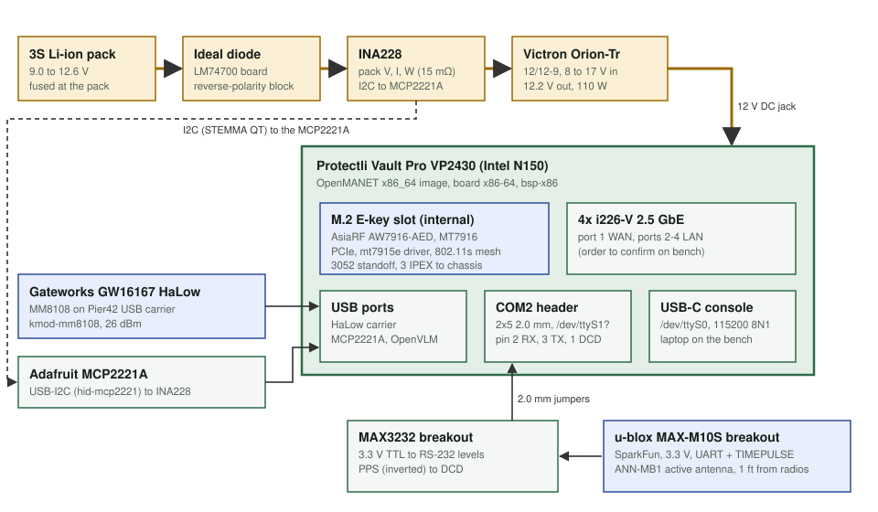

# Bench track: Protectli Vault Pro VP2430e (x86)

This is track 4 of 4 in Stage 2 of the bench compute screen (2026-10-12). It is a challenger to the [CM5 baseline](../cm5/README.md).

The [Protectli VP2430e](https://protectli.com/product/vp2430/) is a fanless x86 box:
- Intel N150 CPU
- Four i226-V 2.5 GbE ports
- An internal M.2 E-key Wi-Fi slot that takes 3052 cards
- An internal RS-232 header with DCD wired
- A 12 V DC input

It runs a stock OpenWrt x86_64 kernel, so most of the node is mainline drivers. Its costs against the CM5 are size, weight and idle power. It also needs a 12 V converter from the 3S pack.

**Status (2026-10-12): software only. Nothing has been bought, and no VP2430 has booted our image.** Purchases go through [GHO-36](https://linear.app/ghostnet-labs/issue/GHO-36) and the Linear Purchase BOM, and only once Justin decides.

| File | What it holds |
|---|---|
| [hardware.md](hardware.md) | What Protectli's datasheet and KB say about power, the M.2 slots, the serial ports, I2C and firmware, with photos |
| [power-budget.md](power-budget.md) | Load-by-load power budget at 12 V and at the 3S pack |
| [build-list.md](build-list.md) | Parts for one bench node (a screening snapshot, not a purchasing record) and the wiring |
| [bring-up.md](bring-up.md) | Firmware setup, flashing, the verification commands and the bench measurements, in order |

## Scorecard

These are the same columns and evidence levels as the [CM5 track](../cm5/README.md#scorecard). Evidence levels run from weakest to strongest:
- **paper**: datasheet, schematic or source reading
- **build-verified**: in a CI-built image, or the build of an open PR
- **boot-verified**: seen running on the hardware
- **bench-measured**: a number taken on the bench

| Column | VP2430e | Evidence |
|---|---|---|
| Wi-Fi card (AW7916-AED, MT7916) | The internal M.2 E-key slot is PCIe 3.0 x1, and its standoff moves to the 3052 position. Protectli sells the AsiaRF AW7916-AED as its own Wi-Fi 6E kit for this box (WM-M2-004, "max 8W"), so the card is vendor-qualified in this exact slot. No adapter is needed. Protectli supplies a thermal pad from the card to the large heatsink. The slot's 3.3 V current limit is not published. `kmod-mt7915e` and `kmod-mt7916-firmware` are in the image | Driver and firmware: **paper** until [firmware #54](https://github.com/ghostnet-labs/firmware/pull/54) builds. Fit: **paper** (vendor statement) |
| HaLow USB (GW16167 on a Pier42 USB carrier) | Goes on any of the four USB 2.0 Type-A ports. `kmod-mm8108` with USB support is in the image | **paper** until firmware #54 builds |
| GNSS + PPS (MAX-M10S + ANN-MB1) | NMEA and PPS run through a MAX3232 to the internal RS-232 header (board label COM2, 2x5 at 2.0 mm). RX is pin 2 and TX is pin 3. PPS goes to DCD on pin 1, so it lands on the board's own UART with no USB latency. gpsd puts the tty into the pps-ldisc line discipline, which creates `/dev/pps0`. The MAX3232 inverts the pulse, and gpsd 3.25 picks the leading edge from the pulse width. The header is expected at `/dev/ttyS1` (Unverified, see [hardware.md](hardware.md#serial-ports)) | **paper** |
| 3S power | A Victron Orion-Tr 12/12-9 isolated buck-boost feeds the 12 V barrel jack. It takes 8 to 17 V in, cuts out at 7 V and holds 12.2 V across the whole 9.0 to 12.6 V pack range. Typical draw is about 15 W from the pack and peak is about 38 W ([power-budget.md](power-budget.md)). The box's 12 V input tolerance is not published | **paper** |
| OpenWrt | New board `x86-64`: the generic x86_64 target with GRUB EFI images, plus `bsp-x86` for the VP2430's GNSS, ntpd, LAN/WAN and battery monitor ([firmware #54](https://github.com/ghostnet-labs/firmware/pull/54), [packages #23](https://github.com/ghostnet-labs/packages/pull/23)). Protectli itself offers OpenWrt 24.10.1 preinstalled, and the box is UEFI only | Config resolves locally: **paper** until CI builds. Boot: not yet |
| Other | **INA228 battery telemetry:** the same chip as the CM5 track and V1, on an MCP2221A USB-I2C bridge. Firmware #54 carries the v6.17 INA228 driver backport plus a `shunt_uohm` parameter, because x86 has no device tree. **Watchdog:** the IT8659E Super I/O watchdog (`kmod-it87-wdt`). **On-board I2C:** the JNTP1 header (I2C0) could replace the USB bridge, but it needs an Intel LPSS kernel module that the image does not have. **Mass:** 1.19 kg and 144 x 143 x 55 mm, against the CM5's carrier-sized footprint | INA228 and watchdog: **paper** until firmware #54 builds |

**Today nothing on this track is build-verified or boot-verified.** It moves to build-verified when the firmware #54 x86-64 image build goes green. It moves to boot-verified only on hardware.

## Software work done for this track

| Change | Where |
|---|---|
| New `x86-64` board: target config, PR image build, install notes | [firmware #54](https://github.com/ghostnet-labs/firmware/pull/54) |
| INA228 driver backport for x86, `shunt_uohm` module parameter, generic `kmod-hwmon-ina238` | [firmware #54](https://github.com/ghostnet-labs/firmware/pull/54) (the same backport as [firmware #53](https://github.com/ghostnet-labs/firmware/pull/53) for the CM5) |
| `bsp-x86`, which does the following on first boot: <ul><li>points gpsd at the RS-232 header</li><li>adds the ntpd NMEA and PPS refclocks</li><li>sets the LAN/WAN ports</li><li>binds the INA228 when the MCP2221A appears</li></ul> | [packages #23](https://github.com/ghostnet-labs/packages/pull/23) |

## Bench measurements still needed

Each of these needs hardware and is not counted as done. The work is tracked on [GHO-86](https://linear.app/ghostnet-labs/issue/GHO-86), and the steps are in [bring-up.md](bring-up.md).
- Which `ttyS` the COM2 header is under the shipped AMI firmware, and whether DCD interrupts arrive on it.
- PPS through the MAX3232: `ppstest` edges and the ntpd PPS offset.
- Idle, working and peak power from the pack, with the Wi-Fi card and HaLow fitted.
- The AW7916-AED at a full TX burst: whether it stays up and how hot it runs under Protectli's thermal pad.
- The Orion-Tr's behaviour at the pack's low end, including cutout and restart.
- The i226 port order (eth0 to eth3 against the chassis labels).
- GNSS C/N0 against stepped HaLow and Wi-Fi power, using the screen's ground-bar layout.
