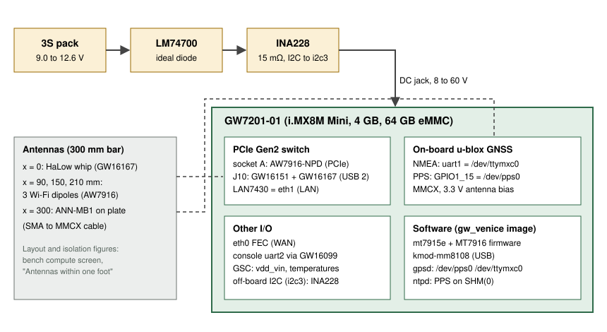

# Bench track: Gateworks Venice GW7201

This is one of the Stage 2 bench tracks from the [bench compute screen](https://claude.ai/artifact/Sm3hWVZPsHHcJnTMRVeCXe), where it is "Challenger A". It builds one OpenMANET node on a Gateworks Venice GW7201-01 so it can be compared, line for line, with the CM5 baseline and the other challengers. Status, open questions and results live in [GHO-85](https://linear.app/ghostnet-labs/issue/GHO-85). The overall comparison is [GHO-50](https://linear.app/ghostnet-labs/issue/GHO-50).

Nothing in this folder has been bought, and nothing here has booted on Venice hardware. Every hardware claim is marked **Verified** (with its source and date) or **Unverified**.

## Why this board earns a track

- **OpenMANET already supports it.** Upstream OpenMANET lists Venice as a tested platform for the MM8108 HaLow radio, and our tree builds the `gw_venice` device ("Venice-MM8108-USB") from `boards/venice`.
- **GNSS with PPS is on the board.**
  - A u-blox receiver sits on `uart1` (`/dev/ttymxc0`), with PPS on `pps-gpio` GPIO1_15. Verified 2026-10-12 against `imx8mm-venice-gw72xx.dtsi`, Linux 6.6.138.
  - The board supplies 3.3 V active-antenna bias with short-circuit protection. Verified 2026-10-12 from the [Gateworks GPS wiki](https://trac.gateworks.com/wiki/gps).
  - No USB-UART and no extra wiring are needed.
- **It takes the pack directly.** Input is 8 to 60 VDC with reverse-voltage protection, so a 3S pack (9.0 to 12.6 V) plugs in without a regulator. Verified 2026-10-12 from the [GW7200 product page](https://www.gateworks.com/products/industrial-single-board-computers/imx8-single-board-computers-gateworks-venice/gw7200-rugged-industrial-single-board-computer/).
- **It is the lowest-idle finalist.** Gateworks publishes 3.9 W typical at 25 °C (163 mA at 24 V). Verified, same page.
- **It is industrial grade.**
  - Operating range is -40 to +85 °C; the board is 70 x 100 x 21 mm and 80 g.
  - The JTAG/console programmer (GW16099) comes in the kit.

## How the node is built

| Part | Role | Detail |
|---|---|---|
| GW7201-01 in the GW11048-2 kit | Compute, GNSS, power entry | [build-list.md](build-list.md) |
| AsiaRF AW7916-NPD, mini-PCIe, fitted directly | Wi-Fi mesh backhaul (`batmesh1`), same MT7916 chip and `mt7915e` driver as the V1 AW7916-AED | [build-list.md](build-list.md), [power-budget.md](power-budget.md) |
| GW16167 HaLow on a GW16151 mini-PCIe to E-key adapter | HaLow mesh (MM8108 over USB 2.0) | [build-list.md](build-list.md) |
| u-blox ANN-MB1 on the board's MMCX GNSS port | GNSS antenna with SAW filtering, per the screen's coexistence budget | [build-list.md](build-list.md) |
| LM74700 ideal diode and INA228 monitor, between the 3S pack and the barrel jack | Reverse/ORing protection and logged input power | [power-budget.md](power-budget.md) |

## Defaults this track picked

These were Claude's software and bench defaults, chosen under Justin's standing delegation. None of them changes a register in this folder's parent.

1. **Use the i.MX8M Mini GW7201-01 (in the GW11048-2 kit), not the i.MX8M Plus GW7201-21.** The 8MM board's compatible already matches our board.d. The 8MP board.d bug is fixed in [firmware #52](https://github.com/ghostnet-labs/firmware/pull/52) but is still unproven on hardware.
2. **Fit the AW7916-NPD directly in a mini-PCIe socket, with no powered interposer, then measure.** The per-socket current limit is not published (question 1 on GHO-85). The bring-up procedure caps TX power until the rail has been measured. A powered interposer is the fallback ([power-budget.md](power-budget.md) §4).
3. **Put the HaLow card in J10 and the Wi-Fi card in the other socket.** J10 is the socket with the PCIe/USB 3.0 mux on `pci_usb_sel`. The HaLow card uses USB 2.0 only, so the mux setting can never cut the Wi-Fi card off. Which physical socket is J10 is still unverified (GHO-85).
4. **Feed the GNSS PPS to gpsd as its own source (`/dev/pps0 /dev/ttymxc0`).** gpsd never links a pps-gpio to a UART on its own, so without this ntpd's PPS source stays empty. Shipped in [packages #21](https://github.com/ghostnet-labs/packages/pull/21) and [firmware #52](https://github.com/ghostnet-labs/firmware/pull/52).
5. **Power the bench from the pack through the LM74700 and INA228, with the kit's supply only for first boot.** The INA228 is read from userspace on the board's off-board I2C header, because our 6.6 kernel has no INA228 hwmon driver ([bring-up.md](bring-up.md) step 9).

## Scorecard

This uses the same six columns as the screen's finalist table. Each cell gives its evidence level:

- **paper**: from datasheets or source.
- **build**: the CI image contains it.
- **boot**: seen working on this board.
- **measured**: a bench number exists.

| Column | Result today | Evidence | What moves it up |
|---|---|---|---|
| Wi-Fi card | ◐ AW7916-NPD direct. Two mini-PCIe Gen2 sockets behind a PCIe switch, 15 W shared across both. Per-socket current is unpublished, against the card's 2.5 to 3 A request. | paper | Bring-up steps 6 and 10: `mt7915e` probes, the 3.3 V rail under full TX, mesh against the CM5 |
| HaLow USB | ● GW16167 on GW16151. Gateworks names this pairing for Venice; `kmod-mm8108` USB is in the `gw_venice` image. | paper, build once [firmware #52](https://github.com/ghostnet-labs/firmware/pull/52) is green | Step 7: `morse` interface up, HaLow mesh against the CM5 |
| GNSS + PPS | ● On-board u-blox on `/dev/ttymxc0` and PPS on GPIO1_15. gpsd and ntpd get the PPS after [packages #21](https://github.com/ghostnet-labs/packages/pull/21) and [firmware #52](https://github.com/ghostnet-labs/firmware/pull/52). | paper (DTS and gpsd source), build once green | Step 8: `ppstest /dev/pps0`, `ntpq -p` selects PPS, C/N0 sweep |
| 3S power | ● 8 to 60 V input with reverse protection; 3S connects directly. Worst-case node draw is about 15.8 W against a "15W" supply figure. | paper | Steps 9 and 10: input power idle and at full TX, from the pack |
| OpenWrt | ● `gw_venice` in our 24.10 tree, Venice PR build in CI. | build once [firmware #52](https://github.com/ghostnet-labs/firmware/pull/52) is green | Step 3: boots the CI image from eMMC |
| Other | ● 2x GbE (FEC and PCIe LAN7430 / `lan743x`), JTAG console, -40 to +85 °C, 3.9 W typical. Most expensive track. | paper | Idle power from the pack at 25 °C |

## Files

- [build-list.md](build-list.md): every part for one node, with photos, sources and alternates.
- [power-budget.md](power-budget.md): rail-by-rail budget, the mini-PCIe socket current question, pack runtime and the fallback.
- [bring-up.md](bring-up.md): flashing, console and a step-by-step check for each subsystem, with pass criteria.

## Code this track changed

- [firmware #52](https://github.com/ghostnet-labs/firmware/pull/52) on `bench/venice`:
  - GW82xx-2x added to `SUPPORTED_DEVICES`;
  - 8MP GW72xx/GW73xx and GW7902 LAN/WAN split fixed;
  - gpsd init takes several devices;
  - openmanet feed pin moved;
  - `pps-tools` added.
- [packages #21](https://github.com/ghostnet-labs/packages/pull/21): bsp-venice feeds `/dev/pps0` to gpsd, ntpd prefers PPS, and the same board.d compatibles are fixed.
