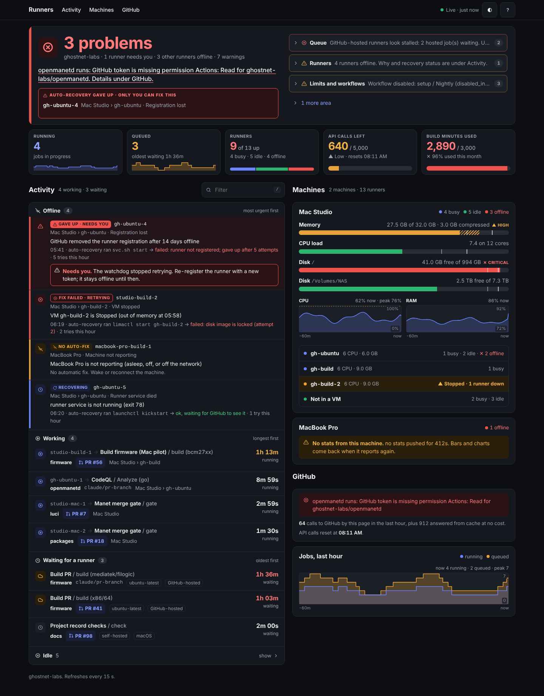
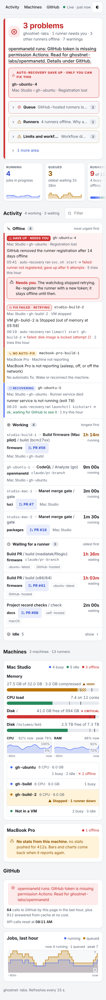

# Runner status page

A small always-on page that shows, without anyone asking:

- every self-hosted runner in the `ghostnet-labs` org, grouped by machine
  (Mac Studio, MacBook Pro, R620 only if it appears),
  with idle / busy / offline, labels and runner group;
- every queued and running Actions job across the org's repos, oldest first,
  with its age, the runner labels it wants and the runner it got;
- alerts: offline or flapping runners, stuck runs, runners held by a merged
  PR, jobs queued 20+ minutes, GitHub-hosted jobs stuck (the usual sign of the
  Actions minutes or spending limit), disabled workflows, low disk, swap,
  sleep settings, growing VM disks, stopped runner services, leftover job
  processes, runner version drift, and the minutes counter when the token can
  read billing (full list under "Alerts");
- each Mac's RAM, CPU load, disks (`/` and `/Volumes/NAS`) and Lima VMs
  (`gh-ubuntu`, `gh-build`, `gh-build-2` on the Studio).

The page refreshes itself every 15 seconds; GitHub is polled every 60
seconds. Each request carries the ETag of its last answer, and GitHub does not
count "304 not changed" answers against the 5,000-an-hour limit, so quiet
repos cost nothing. Only changes are billed (typically a few hundred calls an
hour). The footer shows the calls left, when the hour resets, and how many
calls the page itself used. Below 20% left the page polls every 5 minutes and
says so. While GitHub can't be read at all (bad token), it retries every 15 s
with a single call.



On a phone the same page reads top to bottom: verdict, who needs you, a compact
two-column summary grid, what every runner is doing, then each machine. Secondary incidents
stay collapsed until requested so the urgent item and activity remain near the
top.



### Reading the page

- **Verdict:** one plain sentence at the top ("All clear", "3 problems"). It
  counts distinct problems (one runner, one GitHub failure), not alert lines.
  A runner whose auto-recovery gave up is called out as needing a human.
- **Activity:** offline runners first, most urgent on top, then running jobs
  (longest first), jobs waiting for a runner (oldest first) and idle runners
  (collapsed). Search stays beside the Activity heading. The single Filters
  button opens Dashboard controls, where status filters and sorting/grouping
  live together. A short active-filter summary has a one-click Clear action.
  Every row shows the job, its repo, PR link and a live timer.
- **Machines:** one card per machine with RAM, CPU and disk bars (tick marks
  show the warn and critical levels, a text label says HIGH or CRITICAL so
  colour is never the only signal), 1-hour CPU and RAM charts (hover, tap or
  use the arrow keys for values), swap and memory-pressure facts, report age,
  and its VMs. Machine and VM rows can filter Activity; healthy cards can be
  collapsed together.
- **Freshness:** the pill in the top bar says Live, Stale or Connection lost,
  and a banner appears when the data is more than 10 minutes old. Pause freezes
  refreshes and timers while a snapshot is being investigated.
- **Keys:** `Cmd/Ctrl-K` command palette, `/` search, `j` / `k` move between
  dashboard items, `p` pause, `t` theme, `a` alerts, `i` idle
  runners, `?` help.

### Appearance and personal workflow

The dashboard keeps the Synthesis II color scheme across eleven selectable styles.
Open More → Appearance and layout → Style to switch instantly between
GitHub, Synthesis II, Minimal, Outline, Editorial, Terminal, Blueprint, Soft, Studio,
Ledger, and Command.
The styles vary typography, corners, borders, spacing,
and layout. Auto, Light, and Dark remain independent appearance choices.
The selected style is saved on this device, included in saved views, and can
be shared in a view link. GitHub is the default for new devices, with repository-style
tabs, bordered panels, compact rows, subdued badges, and a flat mobile navigation
bar. All styles use opaque surfaces, solid colors, crisp borders, and no gradients,
backdrop blur, glow, or shadows. Charts use clean lines without tinted area fills.
The glass styles have been retired; saved glass selections fall back to GitHub.
Compressed memory remains identifiable as a lighter solid segment with a divider
and descriptive accessible text. Other existing device selections remain intact.

GitHub styling also uses Primer's system sans-serif and monospace font stacks,
14px body text with 1.5 line height, and 400/500/600 type weights. Navigation,
status, pull-request, search, settings, and utility symbols use official Octicons,
bundled as a local 16px SVG sprite (no CDN or font download). The sprite's pinned
source and MIT license are embedded in the program and in `OCTICONS-LICENSE.txt`.
Status headings use “In progress” and “Queued”.

Git references use GitHub Primer's reference presentation: linked owner/repository
names, numbered PR links with state-specific Octicons, monospace BranchName
labels, seven-character commit links, and PR-detail state labels. Git-specific
colors match Primer primitives 11.10.0 in light/dark mode without changing the
dashboard palette. Open, draft, closed, and merged states come from GitHub;
unavailable states remain neutral. PR title/base/head details appear in the job
inspector. At most 20 distinct active PRs are checked per sweep (busy self-hosted
jobs first); available open-PR list metadata is reused and unchanged requests
use the existing ETag cache. Commit links use the workflow run's actual head SHA.

The GitHub style follows one component contract across dashboard cards and all
secondary screens: scaled 12/13/14/16/20/24px type, 600-weight headings, shared
6px control corners, bordered status badges, and a consistent spacing rhythm.
Controls use 36px desktop targets and at least 44px targets on phones. Dialogs
share opaque surfaces, title bars, labeled close icons, focus outlines, and
footers where appropriate. Save view and reset confirmation stay in-app;
reset remains an explicit destructive confirmation. Dashboard keyboard shortcuts
do not fire behind open dialogs, and closing a dialog restores the entry-point
focus. Filters opens directly at the Activity controls. Machine expand/collapse
actions track the actual card state. Focus mode keeps dialog actions visible.

Dashboard controls groups appearance, live data, machines, saved views and help
into collapsed sections. It controls density, text size, activity-row layout, 15/30/60
minute chart windows, activity-focused or machine-focused workspaces, binary or
decimal units, 12/24-hour time, color-vision palettes, high contrast, reduced
motion, queue SLA and visible sections. Settings, pinned machines, machine
notes, incident acknowledgements, snoozes and saved views stay in that browser's
local storage; none are sent to the server. A shareable view link includes only
the current filter, order, workspace and style.

Other built-in tools include machine comparison, a local alert/change timeline,
plain-language status copying, JSON export, offline snapshot recovery,
label-aware queue explanations, focus mode and a guided feature tour.
Each machine has one More button for pinning, comparison, notes and its activity.
Incident actions stay behind an Actions disclosure. The main summary shows
running jobs, queued jobs and runners; health, API and billing detail is under
Live data and history in Dashboard controls.
The responsive layout uses a bottom navigation bar on iPhone, a stacked layout
on iPad portrait, a split view on iPad landscape, and the full two-column
dashboard on desktop.

### More capability, less clutter

Open **More → Explore** for queue insights, a repository overview, or the local
watchlist. These sheets show oldest/median waits, jobs past the selected wait
target, and queue groups by runner requirements. Repository rows drill into
Activity. The normal queue shows the first 12 jobs; Show 12 more reveals the
rest without changing the full counts or exports.

Use **Details** on a job for its runner/machine/VM assignment, branch, requested
labels, snapshot time, a copyable brief, and a GitHub link. Queued jobs explain
label-matching capacity; this is not a start-time estimate. Repository access,
runner groups, concurrency, approvals, and workflow dependencies may still
affect scheduling. Hosted jobs never count local runners as compatible.

Watch up to 50 jobs locally. A job missing from a later snapshot is marked
outcome unknown, not completed. This is a follow-up list, not notifications.
It is included in Reset personalization and makes no server-side changes.

Activity search accepts combined words, quoted values, exclusions, and fields:
`repo:firmware status:queued -branch:main`, `machine:"Mac Studio"`, `label:linux`,
`runner:studio`, `vm:gh-build`, `workflow:build`, or `pr:42`.
Cmd/Ctrl-K now finds active jobs, machines, saved views, and commands. It is
also available as Find anything in More. Filters → Export matching jobs · CSV
exports all jobs matching the search and status filter, including rows beyond
the first page. CSV values are escaped and formula-prefixed cells neutralized.
Offline/idle runners are not jobs and therefore do not appear in this export.
All investigation tools reuse the existing snapshot without extra API calls.

The 1-hour charts come from samples the server keeps in memory (one every 30
seconds, 120 per series); they cost no GitHub calls and reset on restart.

It is one file, `runner_status.py`, Python 3 standard library only. Nothing to
install. It only reads: it calls GitHub `GET` endpoints with a read-only token
and runs a fixed list of read-only commands (`sysctl`, `vm_stat`, `ps`,
`limactl list`).

## Try it with fake data

```sh
python3 tools/runner-status/runner_status.py serve --demo
# open http://localhost:8090/
```

## 1. Make a read-only token (once)

1. Open <https://github.com/settings/personal-access-tokens/new>.
2. Name `runner-status`, expiration 1 year, **Resource owner: ghostnet-labs**.
3. Repository access: **All repositories**.
4. Repository permissions: **Actions: Read-only** (Metadata read-only is added
   automatically). Optional: **Pull requests: Read-only**, so a job whose run
   doesn't name its PR still shows it (matched by branch). Without it, those
   jobs show only the branch, and the page asks again every 10 minutes.
5. Organization permissions: **Self-hosted runners: Read-only**.
6. Generate, copy the token.
7. If the org asks for approval, approve it at
   <https://github.com/organizations/ghostnet-labs/settings/personal-access-token-requests>.

On the machine that hosts the page:

```sh
mkdir -p ~/.config/runner-status
pbpaste > ~/.config/runner-status/token
chmod 600 ~/.config/runner-status/token
```

`RUNNER_STATUS_TOKEN` in the environment also works. `GITHUB_TOKEN` is used
only when neither of those exists, because on a runner machine it is often
some other, short-lived token. The page footer names the token type and where
it came from (never the token itself).

## 2. Run it on the Mac Studio

```sh
git clone --depth 1 https://github.com/ghostnet-labs/docs ~/runner-status-src
cd ~/runner-status-src/tools/runner-status
python3 runner_status.py launchd serve --notify \
  > ~/Library/LaunchAgents/com.ghostnet.runner-status.serve.plist
launchctl load ~/Library/LaunchAgents/com.ghostnet.runner-status.serve.plist
```

Open `http://<studio-name>.local:8090/` from any device on the LAN (phone
included). The Studio's own stats are read in-process, so it needs no agent.
`--notify` shows a macOS banner on the Studio whenever a new alert appears.
Logs: `~/Library/Logs/runner-status-serve.log`. Update with `git pull` and
`launchctl kickstart -k gui/$(id -u)/com.ghostnet.runner-status.serve`.

The page shows runner names and job titles to anyone on the LAN. Its controls
change only the local presentation; the dashboard remains read-only and holds
no token in the page.

## 3. Show the MacBook Pro (or another Mac)

The Pro sends its own stats to the Studio page every 30 seconds. Nothing
listens on the Pro: it only makes outgoing requests to the page the Studio
already serves. The Studio accepts stats only for machines configured with
`"agent": "push"` (the MacBook Pro is, by default), keeps only the known
fields, and shows "stats missing" if a pushing Mac goes quiet for 3 minutes.
Its runners (`macbook-pro-build-1`) are matched by name.

**Prerequisite:** the Studio page must listen on the network, not only on
the Studio itself. `serve` binds `0.0.0.0` by default; if it was started with
`--bind 127.0.0.1`, remove that and restart it first. Check from the Pro with
`curl -sf http://<studio-name>.local:8090/api/state >/dev/null && echo reachable`.

On the Pro:

```sh
git clone --depth 1 https://github.com/ghostnet-labs/docs ~/runner-status-src
cd ~/runner-status-src/tools/runner-status
python3 runner_status.py launchd push --to http://<studio-name>.local:8090 \
  > ~/Library/LaunchAgents/com.ghostnet.runner-status.push.plist
launchctl load ~/Library/LaunchAgents/com.ghostnet.runner-status.push.plist
```

Log: `~/Library/Logs/runner-status-push.log`. "push failed: cannot reach the
Studio page" means the prerequisite above is not met or the Studio is asleep;
the MacBook Pro card on the page then says "stats missing".

**Push key (required).** The Studio refuses pushed stats unless they carry a
shared key, so nothing else on the LAN can post fake numbers. Make it on the
Studio and copy it to the clipboard:

```sh
mkdir -p ~/.config/runner-status
openssl rand -hex 24 | tee ~/.config/runner-status/push-key | pbcopy
chmod 600 ~/.config/runner-status/push-key
```

Then on the Pro (Universal Clipboard carries it across, or paste it by hand):

```sh
mkdir -p ~/.config/runner-status
pbpaste > ~/.config/runner-status/push-key
chmod 600 ~/.config/runner-status/push-key
```

Both sides re-read the file, so no restart is needed after it changes.

To give a machine a different name or runner pattern, create
`~/.config/runner-status/config.json` on the Studio:

```json
{
  "machines": [
    {"name": "Mac Studio", "agent": "local", "runner_pattern": "(?i)studio|gh-ubuntu|gh-build"},
    {"name": "MacBook Pro", "agent": "push", "runner_pattern": "(?i)macbook|mac-dev|\\bdev\\b"},
    {"name": "R620", "agent": "", "runner_pattern": "(?i)r620"}
  ]
}
```

A Mac can instead run `runner_status.py agent` (a read-only listener on
:8091) and be configured with `"agent": "http://<name>.local:8091"`; push is
preferred because it opens no port.

A runner belongs to the first machine whose `runner_pattern` matches its
name; unmatched runners show under "Other runners", so a wrong pattern never
hides one. Other keys: `poll_seconds`, `queued_alert_minutes`,
`hosted_stall_minutes`, `disk_paths`.

## Alerts

Every alert shows at the top of the page (and as a macOS banner with
`--notify`). None of them costs extra GitHub calls except the PR check, which
is one cached call per PR that a busy runner is working for (unchanged PRs
answer "304" for free), and one call every 10 minutes for the newest runner
release.

| Alert | Fires when | Setting (config.json) |
|---|---|---|
| Offline runners | A runner is offline; red after it has been offline this long | `offline_crit_minutes` (30) |
| Flapping runners | A runner went offline and back this many times in an hour | `flap_changes_per_hour` (4) |
| Stuck run | A job has been running longer than this | `stuck_run_hours` (4) |
| Runner held by a closed PR | A busy runner's job belongs to a PR that is already merged or closed (cancel the run) | always on |
| Disk low | A watched disk has less than this share free | `disk_alert_free_pct` (10) |
| Swapping / memory pressure | Swap in use above this many GiB, or macOS memory pressure high or critical | `swap_alert_gb` (4) |
| Sleeps on power | A listed Mac would sleep on AC power (`pmset -c sleep` not 0) | `no_sleep_machines` |
| VM disk image | A Lima VM's disk image on the Mac has filled past this share of its size (it only shrinks after `fstrim` in the VM, which the cleanup does) | `vm_disk_alert_pct` (85) |
| Runner service not running | A `actions.runner.*` launchd service on the Mac has no process | always on |
| Leftover job processes | A process from a runner `_work` dir outlived its job (re-parented to launchd) for over an hour | always on |
| VM drift | `tools/ci-hosts/verify-vm.sh` (run hourly in each VM by the watchdog) reports a VM that no longer matches the committed setup, e.g. runc back in an OpenWrt build VM | `vm_roles` per machine |
| Runner version behind | A runner dir under `runner_roots` logs an older version than the newest release, two days after that release | `runner_roots` (`["~"]`) |
| Queued, hosted stall, disabled workflow, minutes, API quota | As before | `queued_alert_minutes`, `hosted_stall_minutes` |

Machine checks run on the Macs themselves (`sysctl`, `pmset -g custom`,
`launchctl list`, `ps`, `limactl list`, and a stat of each VM's disk image),
all read-only. The Linux runners inside the VMs are covered by the GitHub
side (offline, flapping, stuck, closed PR) and by the VM disk-image check.

## Daily cleanup

`runner_cleanup.py` finds old runner checkouts, temp files, runner logs and
oversized logs on a runner host and inside its Lima VMs. It only reports by
default; `--apply` removes. It never touches a runner that is running a job,
the runner's own files, or anything outside the runner `_work` and `_diag`
directories and the listed logs. See `python3 runner_cleanup.py --help`.

```sh
python3 tools/runner-status/runner_cleanup.py            # report only
python3 tools/runner-status/runner_cleanup.py --apply    # clean
```

Install it as a daily LaunchAgent (04:30, low priority) after one dry run
looks right:

```sh
python3 runner_cleanup.py --print-launchd \
  > ~/Library/LaunchAgents/com.ghostnet.runner-cleanup.plist
launchctl load ~/Library/LaunchAgents/com.ghostnet.runner-cleanup.plist
```

Log: `~/Library/Logs/runner-cleanup.log`.

## Watchdog: why a runner is offline, and getting it back

`runner_watchdog.py` runs every 2 minutes on each runner Mac. It reads this
page's `/api/state` to see which of its runners GitHub reports offline (no
token needed), works out why on the Mac, fixes what is safe to fix, and writes
`~/.config/runner-status/watchdog.json`. The page shows that reason and the
last recovery step under each offline runner and in the offline alert.

| Cause | What it does |
|---|---|
| Listed in `maintenance.json` | Nothing; shown as "Draining for maintenance" (blue, not a fault) |
| Lima VM stopped | `limactl start <vm>` (once for all its runners) |
| Runner service stopped | `launchctl kickstart -k` (Mac) or `systemctl restart` (in the VM) |
| Service runs but GitHub sees it offline | Restart the service |
| VM cannot reach github.com | `limactl restart <vm>` |
| Registration removed or credentials refused | Nothing; needs re-registering |
| Disk nearly full (under 2 GB) | Nothing; run the cleanup |
| The Mac cannot reach github.com | Nothing |
| No service for that runner | Runs `--jit-command <name>` if given, else nothing |
| The Mac itself is silent (asleep, off) | Shown by the page from missing stats |

Restarts back off 2, 4 and 8 minutes and stop after 3 tries in an hour, so a
runner that cannot come back is never restarted in a loop; the page then says
auto-recovery gave up. `--dry-run` diagnoses without changing anything.

Before taking runners down on purpose (for example the one-job runner
conversion), list them in `~/.config/runner-status/maintenance.json`:

```json
{"entries": [{"runner": "^gh-ubuntu", "reason": "one-job runner conversion",
              "until": "2026-10-13T12:00:00Z"}]}
```

Install on the Studio (the page runs there):

```sh
python3 runner_watchdog.py launchd --machine "Mac Studio" \
  > ~/Library/LaunchAgents/com.ghostnet.runner-watchdog.plist
launchctl load ~/Library/LaunchAgents/com.ghostnet.runner-watchdog.plist
```

On the MacBook Pro add `--page http://<studio-name>.local:8090` and
`--machine "MacBook Pro"`; its report reaches the page with the pushed stats.
Log: `~/Library/Logs/runner-watchdog.log`.

## Troubleshooting

Problems show as red alerts at the top of the page, in plain words:

| Alert says | Meaning | Fix |
|---|---|---|
| No GitHub token | No token file | Step 1 |
| token rejected (401) | Token wrong, expired or revoked, or not the one you meant (check the footer's "Using ... from ...") | Make a new token and overwrite the file; picked up on the next poll |
| missing permission | The token lacks the named permission | Edit the token on GitHub and add it; no restart needed |
| waiting for org-owner approval | Org requires approval for fine-grained tokens | Approve it in the org's token requests |
| org does not allow fine-grained tokens | Org policy blocks them | Allow them in org Settings > Personal access tokens |

If fine-grained tokens cannot be used at all, a classic token works too, but
listing org runners needs the `admin:org` scope, which also grants write
access to the org. Prefer the fine-grained token.

## Tests

```sh
python3 -m unittest discover -s tools/runner-status -v
```
