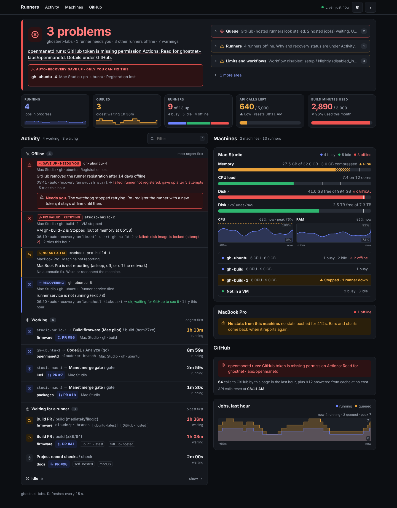
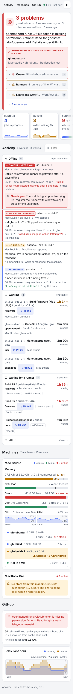

# Runner status page

A small always-on page that shows, without anyone asking:

- every self-hosted runner in the `ghostnet-labs` org, grouped by machine
  (Mac Studio, MacBook Pro, R620 only if it appears),
  with idle / busy / offline, labels and runner group;
- every queued and running Actions job across the org's repos, oldest first,
  with its age, the runner labels it wants and the runner it got;
- alerts: offline runners, jobs queued 20+ minutes, GitHub-hosted jobs stuck
  (the usual sign of the Actions minutes or spending limit), disabled
  workflows, low disk, stopped Lima VMs, and the minutes counter when the
  token can read billing;
- each Mac's RAM, CPU load, disks (`/` and `/Volumes/NAS`) and Lima VMs
  (`gh-ubuntu`, `gh-build`, `gh-build-2` on the Studio).

The page refreshes itself every 15 seconds; GitHub is polled every 60
seconds. Each request carries the ETag of its last answer, and GitHub does not
count "304 not changed" answers against the 5,000-an-hour limit, so quiet
repos cost nothing. Only changes are billed (typically a few hundred calls an
hour). The footer shows the calls left, when the hour resets, and how many
calls the page itself used. Below 20% left the page polls every 5 minutes and
says so. While GitHub can't be read at all (bad token), it retries every 15 s
with a single call.



On a phone the same page reads top to bottom: verdict, who needs you, a
swipeable strip of counts, what every runner is doing, then each machine.



### Reading the page

- **Verdict:** one plain sentence at the top ("All clear", "3 problems"). It
  counts distinct problems (one runner, one GitHub failure), not alert lines.
  A runner whose auto-recovery gave up is called out as needing a human.
- **Activity:** offline runners first, most urgent on top, then running jobs
  (longest first), jobs waiting for a runner (oldest first) and idle runners
  (collapsed). Every row shows the job, its repo, PR link and a live timer.
- **Machines:** one card per machine with RAM, CPU and disk bars (tick marks
  show the warn and critical levels, a text label says HIGH or CRITICAL so
  colour is never the only signal), 1-hour CPU and RAM charts (hover, tap or
  use the arrow keys for values), and its VMs.
- **Freshness:** the pill in the top bar says Live, Stale or Connection lost,
  and a banner appears when the data is more than 10 minutes old.
- **Keys:** `/` filter, `t` theme, `a` alerts, `i` idle runners, `?` help.

The 1-hour charts come from samples the server keeps in memory (one every 30
seconds, 120 per series); they cost no GitHub calls and reset on restart.

It is one file, `runner_status.py`, Python 3 standard library only. Nothing to
install. It only reads: it calls GitHub `GET` endpoints with a read-only token
and runs a fixed list of read-only commands (`sysctl`, `vm_stat`, `ps`,
`limactl list`).

## Try it with fake data

```sh
python3 tools/runner-status/runner_status.py serve --demo
# open http://localhost:8090/
```

## 1. Make a read-only token (once)

1. Open <https://github.com/settings/personal-access-tokens/new>.
2. Name `runner-status`, expiration 1 year, **Resource owner: ghostnet-labs**.
3. Repository access: **All repositories**.
4. Repository permissions: **Actions: Read-only** (Metadata read-only is added
   automatically). Optional: **Pull requests: Read-only**, so a job whose run
   doesn't name its PR still shows it (matched by branch). Without it, those
   jobs show only the branch, and the page asks again every 10 minutes.
5. Organization permissions: **Self-hosted runners: Read-only**.
6. Generate, copy the token.
7. If the org asks for approval, approve it at
   <https://github.com/organizations/ghostnet-labs/settings/personal-access-token-requests>.

On the machine that hosts the page:

```sh
mkdir -p ~/.config/runner-status
pbpaste > ~/.config/runner-status/token
chmod 600 ~/.config/runner-status/token
```

`RUNNER_STATUS_TOKEN` in the environment also works. `GITHUB_TOKEN` is used
only when neither of those exists, because on a runner machine it is often
some other, short-lived token. The page footer names the token type and where
it came from (never the token itself).

## 2. Run it on the Mac Studio

```sh
git clone --depth 1 https://github.com/ghostnet-labs/docs ~/runner-status-src
cd ~/runner-status-src/tools/runner-status
python3 runner_status.py launchd serve --notify \
  > ~/Library/LaunchAgents/com.ghostnet.runner-status.serve.plist
launchctl load ~/Library/LaunchAgents/com.ghostnet.runner-status.serve.plist
```

Open `http://<studio-name>.local:8090/` from any device on the LAN (phone
included). The Studio's own stats are read in-process, so it needs no agent.
`--notify` shows a macOS banner on the Studio whenever a new alert appears.
Logs: `~/Library/Logs/runner-status-serve.log`. Update with `git pull` and
`launchctl kickstart -k gui/$(id -u)/com.ghostnet.runner-status.serve`.

The page shows runner names and job titles to anyone on the LAN. It has no
controls and holds no token in the page.

## 3. Show the MacBook Pro (or another Mac)

The Pro sends its own stats to the Studio page every 30 seconds. Nothing
listens on the Pro: it only makes outgoing requests to the page the Studio
already serves. The Studio accepts stats only for machines configured with
`"agent": "push"` (the MacBook Pro is, by default), keeps only the known
fields, and shows "stats missing" if a pushing Mac goes quiet for 3 minutes.
Its runners (`macbook-pro-build-1`) are matched by name.

**Prerequisite:** the Studio page must listen on the network, not only on
the Studio itself. `serve` binds `0.0.0.0` by default; if it was started with
`--bind 127.0.0.1`, remove that and restart it first. Check from the Pro with
`curl -sf http://<studio-name>.local:8090/api/state >/dev/null && echo reachable`.

On the Pro:

```sh
git clone --depth 1 https://github.com/ghostnet-labs/docs ~/runner-status-src
cd ~/runner-status-src/tools/runner-status
python3 runner_status.py launchd push --to http://<studio-name>.local:8090 \
  > ~/Library/LaunchAgents/com.ghostnet.runner-status.push.plist
launchctl load ~/Library/LaunchAgents/com.ghostnet.runner-status.push.plist
```

Log: `~/Library/Logs/runner-status-push.log`. "push failed: cannot reach the
Studio page" means the prerequisite above is not met or the Studio is asleep;
the MacBook Pro card on the page then says "stats missing".

**Push key (required).** The Studio refuses pushed stats unless they carry a
shared key, so nothing else on the LAN can post fake numbers. Make it on the
Studio and copy it to the clipboard:

```sh
mkdir -p ~/.config/runner-status
openssl rand -hex 24 | tee ~/.config/runner-status/push-key | pbcopy
chmod 600 ~/.config/runner-status/push-key
```

Then on the Pro (Universal Clipboard carries it across, or paste it by hand):

```sh
mkdir -p ~/.config/runner-status
pbpaste > ~/.config/runner-status/push-key
chmod 600 ~/.config/runner-status/push-key
```

Both sides re-read the file, so no restart is needed after it changes.

To give a machine a different name or runner pattern, create
`~/.config/runner-status/config.json` on the Studio:

```json
{
  "machines": [
    {"name": "Mac Studio", "agent": "local", "runner_pattern": "(?i)studio|gh-ubuntu|gh-build"},
    {"name": "MacBook Pro", "agent": "push", "runner_pattern": "(?i)macbook|mac-dev|\\bdev\\b"},
    {"name": "R620", "agent": "", "runner_pattern": "(?i)r620"}
  ]
}
```

A Mac can instead run `runner_status.py agent` (a read-only listener on
:8091) and be configured with `"agent": "http://<name>.local:8091"`; push is
preferred because it opens no port.

A runner belongs to the first machine whose `runner_pattern` matches its
name; unmatched runners show under "Other runners", so a wrong pattern never
hides one. Other keys: `poll_seconds`, `queued_alert_minutes`,
`hosted_stall_minutes`, `disk_paths`.

## Troubleshooting

Problems show as red alerts at the top of the page, in plain words:

| Alert says | Meaning | Fix |
|---|---|---|
| No GitHub token | No token file | Step 1 |
| token rejected (401) | Token wrong, expired or revoked, or not the one you meant (check the footer's "Using ... from ...") | Make a new token and overwrite the file; picked up on the next poll |
| missing permission | The token lacks the named permission | Edit the token on GitHub and add it; no restart needed |
| waiting for org-owner approval | Org requires approval for fine-grained tokens | Approve it in the org's token requests |
| org does not allow fine-grained tokens | Org policy blocks them | Allow them in org Settings > Personal access tokens |

If fine-grained tokens cannot be used at all, a classic token works too, but
listing org runners needs the `admin:org` scope, which also grants write
access to the org. Prefer the fine-grained token.

## Tests

```sh
python3 -m unittest discover -s tools/runner-status -v
```
